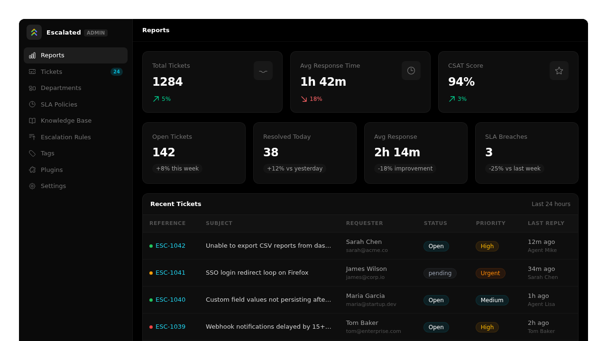
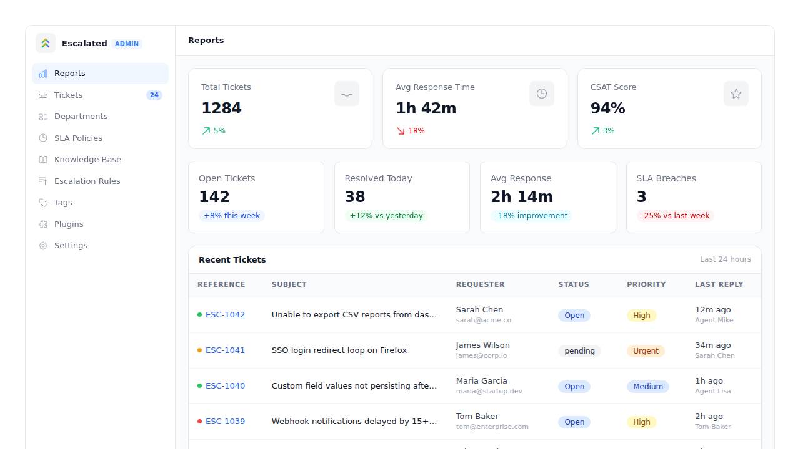
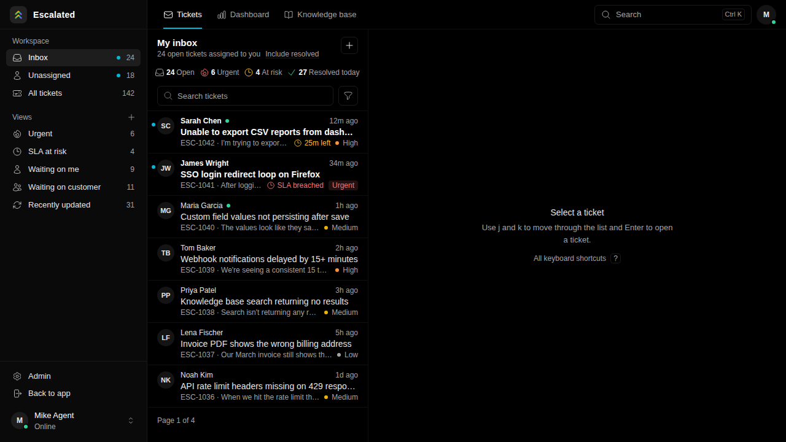
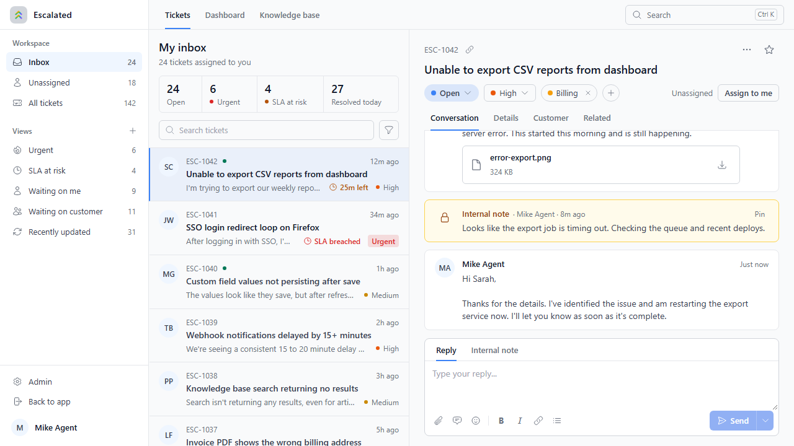
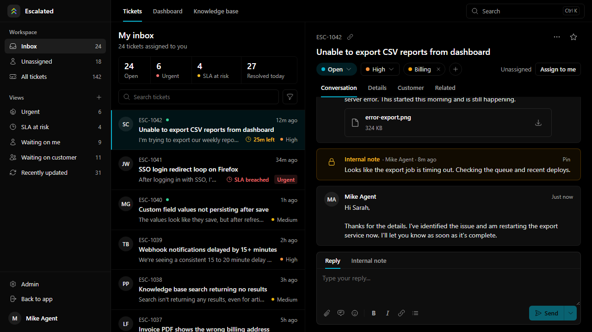

# What's in this package

## What's in This Repo

All the Vue 3 + Inertia.js components that power the Escalated UI. These are identical across Laravel, Rails, Django, and AdonisJS — the backend framework renders them via Inertia.

## 📸 Screenshots

> Screenshots are auto-generated from Storybook via the [component-screenshots](../.github/workflows/screenshots.yml) workflow.

  <strong>Admin Panel (Dark)</strong> 
  

  <strong>Admin Panel (Light)</strong> 
  

  <strong>Agent Inbox</strong> 
  

  <strong>Agent Panel (Light)</strong> 
  

  <strong>Ticket View</strong> 
  

### Pages

**Customer Portal** — Self-service ticket management
- `pages/Customer/Index.vue` — Ticket list with status filters and search
- `pages/Customer/Create.vue` — New ticket form with file attachments
- `pages/Customer/Show.vue` — Ticket detail with reply thread

**Agent Dashboard** — Ticket queue and workflows
- `pages/Agent/Dashboard.vue` — Stats overview and recent tickets
- `pages/Agent/TicketIndex.vue` — Filterable ticket queue
- `pages/Agent/TicketShow.vue` — Full ticket view with sidebar, internal notes, canned responses

**Admin Panel** — System configuration
- `pages/Admin/Reports.vue` — Analytics dashboard
- `pages/Admin/Departments/` — Department CRUD
- `pages/Admin/SlaPolicies/` — SLA policy management
- `pages/Admin/EscalationRules/` — Escalation rule builder
- `pages/Admin/Tags/` — Tag management
- `pages/Admin/CannedResponses/` — Canned response templates

### Shared Components

Reusable building blocks used across the pages above.

| Component | Description |
|-----------|-------------|
| `StatusBadge` | Colored badge for ticket status |
| `PriorityBadge` | Colored badge for ticket priority |
| `TicketList` | Paginated ticket table |
| `ReplyThread` | Chronological reply display |
| `ReplyComposer` | Reply/note editor with file upload and canned response insertion |
| `ActivityTimeline` | Audit log of ticket events |
| `SlaTimer` | SLA countdown with breach/warning states |
| `TicketFilters` | Status, priority, agent, department filter bar |
| `TicketSidebar` | Ticket detail sidebar (status, SLA, tags, activity) |
| `AssigneeSelect` | Agent assignment dropdown |
| `TagSelect` | Multi-select tag picker |
| `FileDropzone` | Drag-and-drop file upload |
| `AttachmentList` | File attachment display with download links |
| `StatsCard` | Metric card with label, value, and trend |
| `EscalatedLayout` | Top-level layout with navigation (supports host layout injection) |
| `BulkActionBar` | Toolbar for batch operations on selected tickets |
| `QuickFilters` | One-click filter chips (My Tickets, Unassigned, Urgent, SLA Breaching) |
| `MacroDropdown` | Dropdown to apply multi-step macros to a ticket |
| `FollowButton` | Toggle button to follow/unfollow a ticket |
| `SatisfactionRating` | 1-5 star CSAT rating input with optional comment |
| `KeyboardShortcutHelp` | Modal overlay showing all available keyboard shortcuts |
| `PinnedNotes` | Display pinned internal notes at the top of the thread |
| `PresenceIndicator` | Real-time indicator showing who is viewing a ticket |

### Composables

| Composable | Description |
|------------|-------------|
| `useKeyboardShortcuts` | Registers and manages keyboard shortcuts for ticket actions |

### Plugin

| Export | Description |
|--------|-------------|
| `EscalatedPlugin` | Vue plugin for layout injection and CSS theming |
