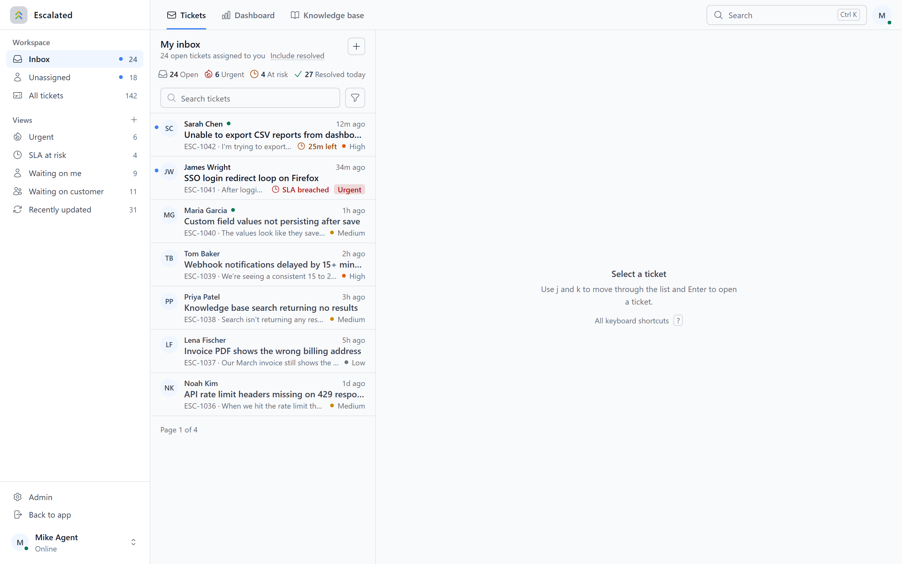
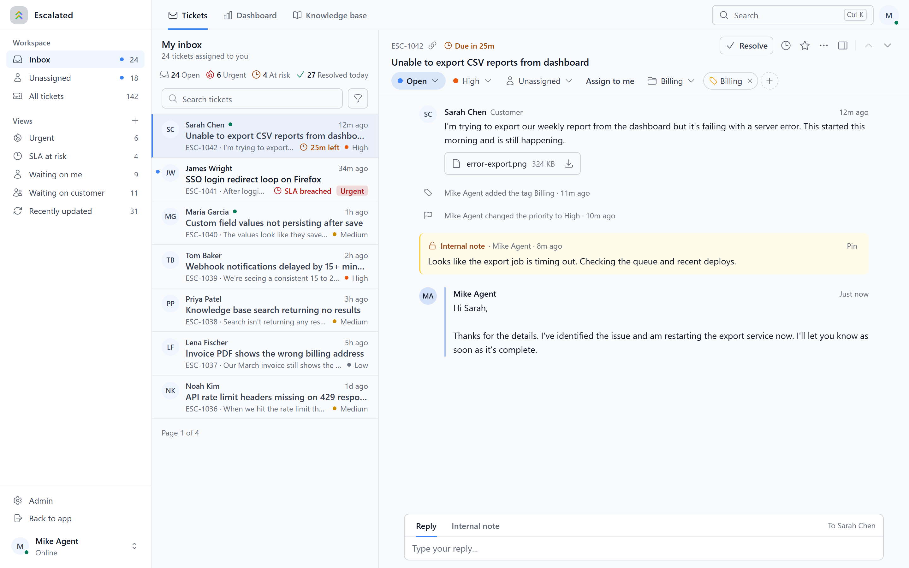
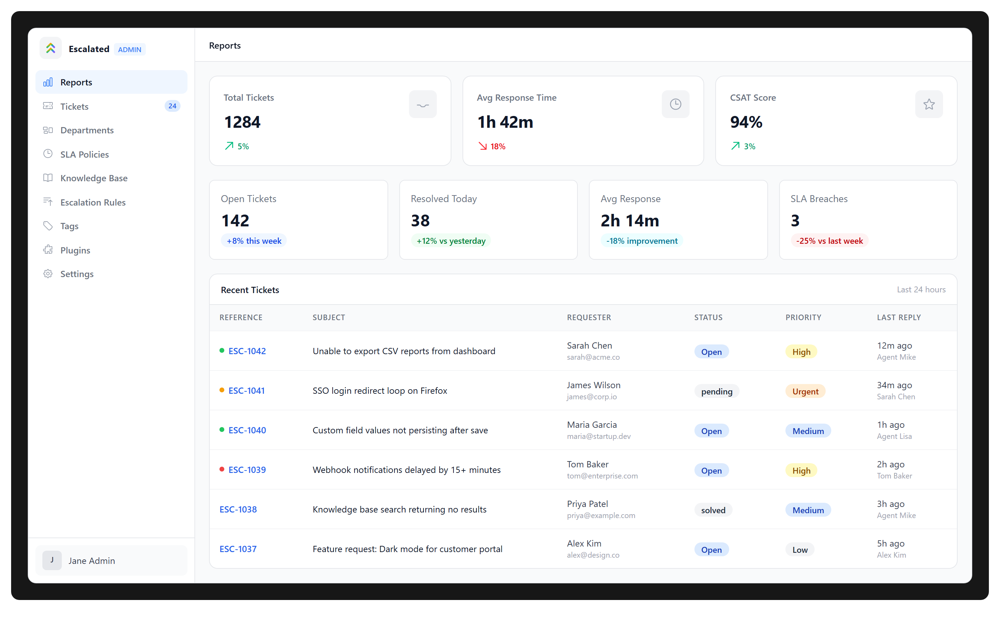
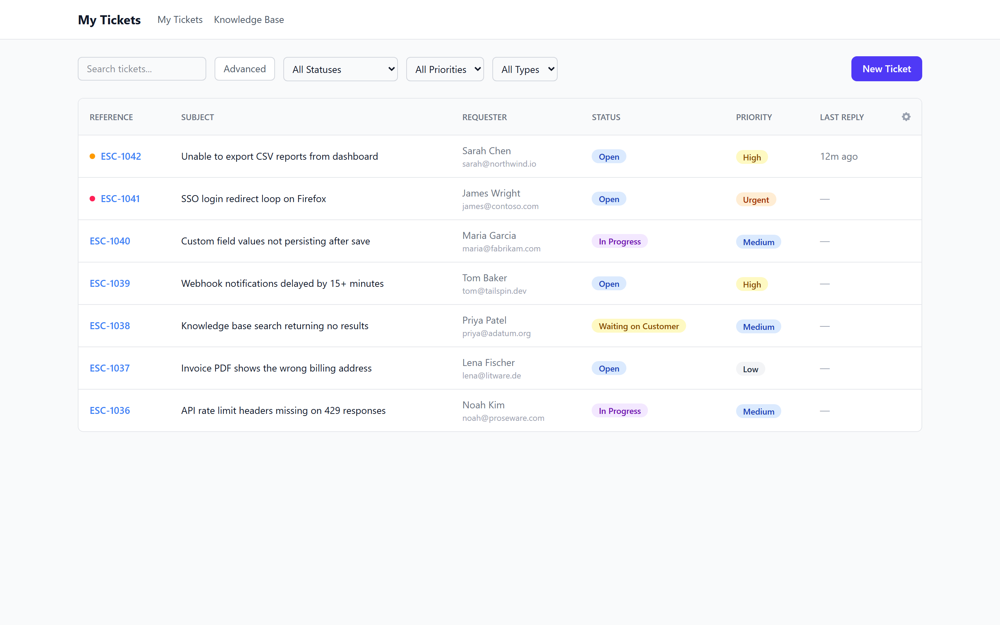

  <a href="README.ar.md">العربية</a> ·
  <a href="README.de.md">Deutsch</a> ·
  <a href="../../README.md">English</a> ·
  <a href="README.es.md">Español</a> ·
  <a href="README.fr.md">Français</a> ·
  <a href="README.it.md">Italiano</a> ·
  <a href="README.ja.md">日本語</a> ·
  <a href="README.ko.md">한국어</a> ·
  <a href="README.nl.md">Nederlands</a> ·
  <b>Polski</b> ·
  <a href="README.pt-BR.md">Português (BR)</a> ·
  <a href="README.ru.md">Русский</a> ·
  <a href="README.tr.md">Türkçe</a> ·
  <a href="README.zh-CN.md">简体中文</a>

  

<h1 align="center">Escalated</h1>

  Zgłoszenia supportowe wbudowane w Twoją aplikację. 
  Helpdesk open source z SLA, regułami eskalacji, skrzynką dla agentów i portalem klienta.

  <a href="https://escalated.dev"><b>Strona</b></a> ·
  <a href="https://escalated.dev/docs"><b>Dokumentacja</b></a> ·
  <a href="https://escalated.dev/cloud"><b>Cloud</b></a> ·
  <a href="../../CHANGELOG.md"><b>Lista zmian</b></a>

 

<picture>
  <source media="(prefers-color-scheme: dark)" srcset="../assets/readme/inbox-dark.png">
  
</picture>

## Co potrafi

<table>
  <tr>
    <td width="40%">
      <h3>Skrzynka, w której Twoi agenci mogą pracować cały dzień</h3>
      Rozmowa, notatki wewnętrzne, gotowe odpowiedzi i liczniki SLA na jednym ekranie, ze skrótami klawiszowymi do poruszania się po kolejce.
    </td>
    <td width="60%">
      <picture>
        <source media="(prefers-color-scheme: dark)" srcset="../assets/readme/ticket-dark.png">
        
      </picture>
    </td>
  </tr>
  <tr>
    <td width="60%">
      <picture>
        <source media="(prefers-color-scheme: dark)" srcset="../assets/readme/dashboard-dark.png">
        
      </picture>
    </td>
    <td width="40%">
      <h3>Widoczne SLA i reguły eskalacji</h3>
      Ustaw cele odpowiedzi i rozwiązania dla każdego priorytetu, eskaluj automatycznie, gdy nie są dotrzymywane, i śledź naruszenia na stronie raportów.
    </td>
  </tr>
  <tr>
    <td width="40%">
      <h3>Gotowy portal klienta</h3>
      Klienci otwierają zgłoszenia, odpowiadają i sprawdzają status w Twojej aplikacji, a obok mają bazę wiedzy. Możesz też osadzić widżet na dowolnej stronie.
    </td>
    <td width="60%">
      <picture>
        <source media="(prefers-color-scheme: dark)" srcset="../assets/readme/portal-dark.png">
        
      </picture>
    </td>
  </tr>
</table>

## Szybki start

Ten pakiet to wspólny frontend Vue 3 + Inertia. Nie instalujesz go osobno: dodaj pakiet dla swojego backendu, a ten interfejs przyjdzie razem z nim.

<table>
  <tr>
    <td align="center"><a href="https://github.com/escalated-dev/escalated-laravel"><b>Laravel</b></a></td>
    <td align="center"><a href="https://github.com/escalated-dev/escalated-rails"><b>Rails</b></a></td>
    <td align="center"><a href="https://github.com/escalated-dev/escalated-django"><b>Django</b></a></td>
    <td align="center"><a href="https://github.com/escalated-dev/escalated-nestjs"><b>NestJS</b></a></td>
    <td align="center"><a href="https://github.com/escalated-dev/escalated-adonis"><b>AdonisJS</b></a></td>
    <td align="center"><a href="https://github.com/escalated-dev/escalated-symfony"><b>Symfony</b></a></td>
    <td align="center"><a href="https://github.com/escalated-dev/escalated-phoenix"><b>Phoenix</b></a></td>
  </tr>
  <tr>
    <td align="center"><a href="https://github.com/escalated-dev/escalated-go"><b>Go</b></a></td>
    <td align="center"><a href="https://github.com/escalated-dev/escalated-dotnet"><b>.NET</b></a></td>
    <td align="center"><a href="https://github.com/escalated-dev/escalated-spring"><b>Spring</b></a></td>
    <td align="center"><a href="https://github.com/escalated-dev/escalated-wordpress"><b>WordPress</b></a></td>
    <td align="center"><a href="https://github.com/escalated-dev/escalated-filament"><b>Filament</b></a></td>
    <td align="center"><a href="https://github.com/escalated-dev/escalated-react-native"><b>React Native</b></a></td>
    <td align="center"><a href="https://github.com/escalated-dev/escalated-flutter"><b>Flutter</b></a></td>
  </tr>
</table>

## Dowiedz się więcej

- [Wszystkie funkcje](../features.md)
- [Pierwsze kroki z każdym backendem](../getting-started.md)
- [Integracja z aplikacją: Tailwind, motywy, osadzanie panelu administracyjnego](../host-integration.md)
- [Tokeny motywów](../theming.md) · [Panel agenta](../agent-panel.md) · [Osadzanie widżetu](../embedding-the-widget.md)
- [Strony i komponenty w tym pakiecie](../components.md)
- [Tworzenie wtyczek](../plugin-development.md)
- [Dla opiekunów pakietów](../package-maintainers.md)
- [Współtworzenie](../../CONTRIBUTING.md)

## Licencja

MIT. Copyright (c) Escalated.dev. Zobacz [LICENSE](../../LICENSE).
